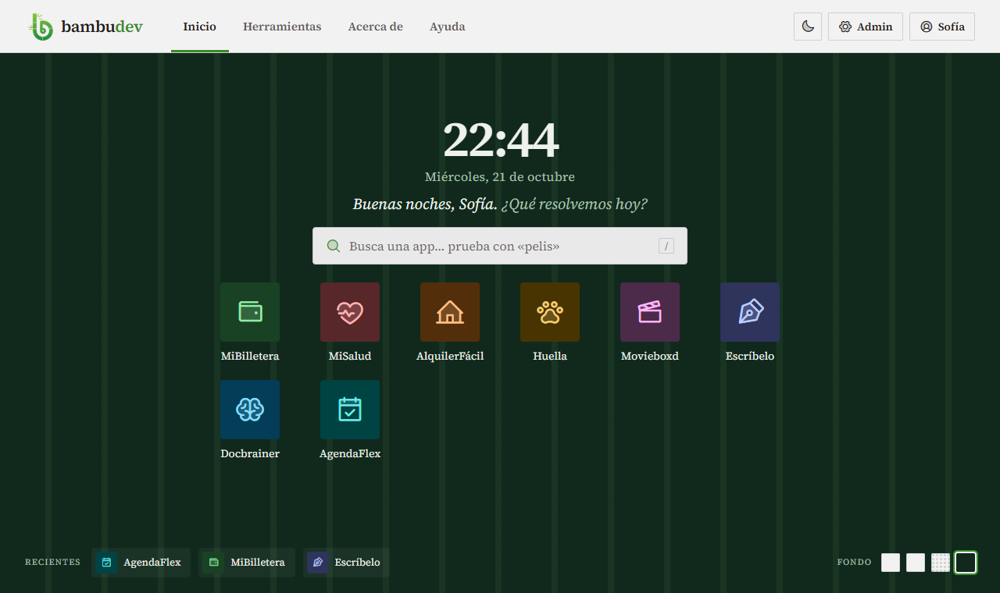
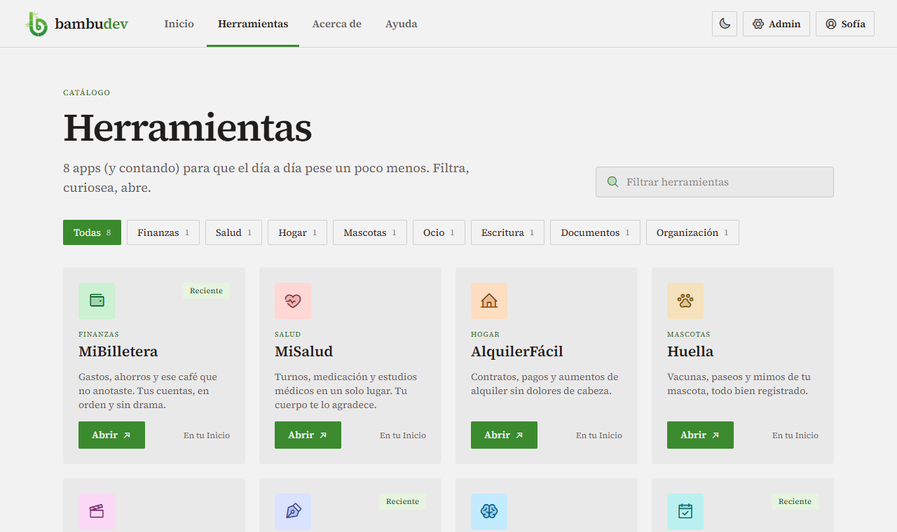
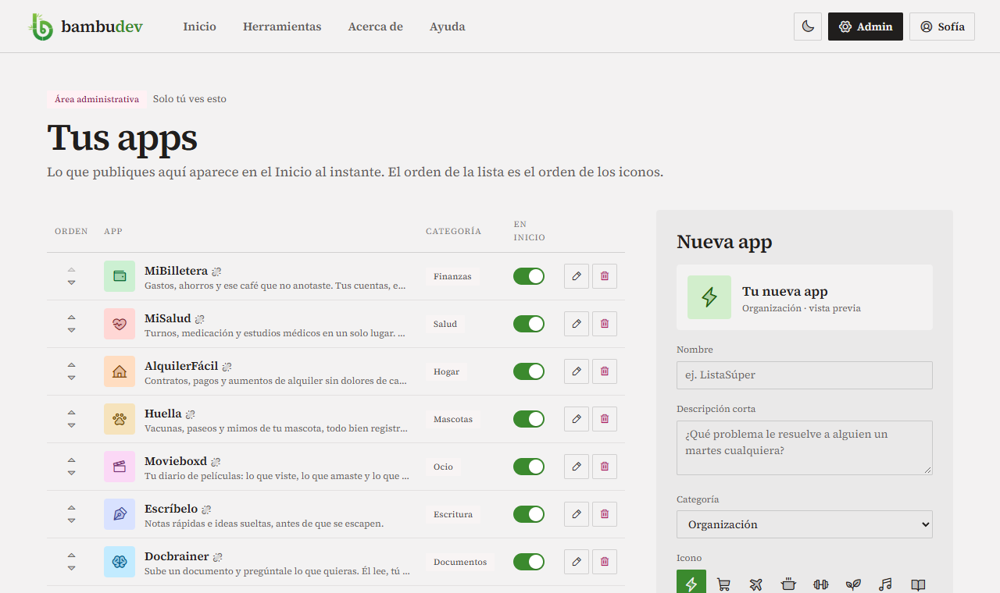
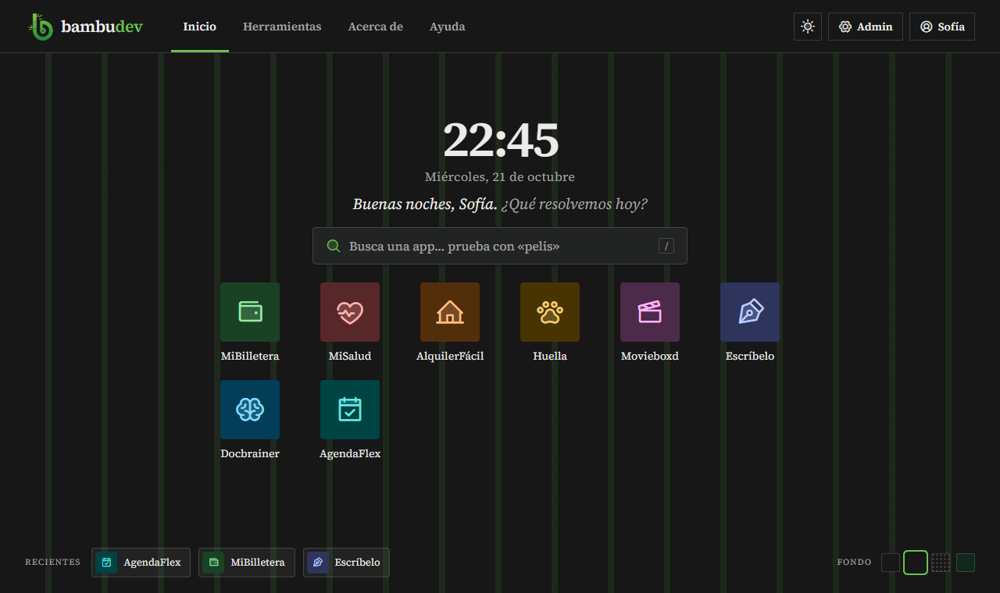
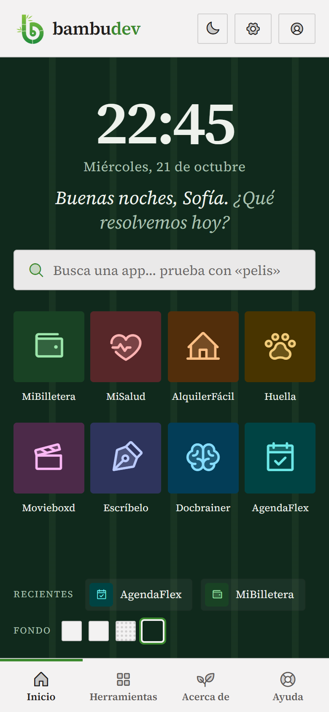

<p align="center">
  
</p>

<h1 align="center">bambudev</h1>

<p align="center">
  <em>Apps pequeñas para que los días grandes salgan bien.</em>
</p>

<p align="center">
  
  
  
  
  
</p>

---

**bambudev** es una sola puerta de entrada a un conjunto de micro apps para la vida diaria: los gastos, la salud, el alquiler, la mascota, las películas, la agenda. Cada app resuelve un problema chico y concreto. bambudev las reúne detrás de una cuenta y un Inicio que funciona como el escritorio de un sistema operativo.



## Qué hace

**Un Inicio tipo launcher.** Ocupa toda la pantalla, sin scroll. Muestra la hora, la fecha, un saludo según el momento del día («Buenas tardes, Sofía. ¿Qué resolvemos hoy?») y las apps como íconos en páginas de 12.

- **Buscador:** encuentra apps por nombre, categoría, descripción o palabras clave, sin importar acentos ni mayúsculas. Si buscas «pelis», aparece Movieboxd.
- **Atajos de teclado:** `/` enfoca el buscador, `Enter` abre el primer resultado, `← →` cambia de página y `Esc` cierra.
- **Páginas deslizables:** se pasa de página arrastrando con el dedo o con el mouse, o tocando los puntitos de abajo.
- **Recientes:** las últimas apps que abriste quedan a mano en la barra inferior.
- **Cuatro fondos:** Papel, Bambú, Trama y Bosque.

**Un catálogo de Herramientas.** Muestra todas las apps en tarjetas, con filtros por categoría y un buscador.

**Un área de administración.** Ahí se publican apps nuevas, con vista previa en vivo del ícono, y se editan, se reordenan, se ocultan o se eliminan. El orden de la lista es el orden de los íconos en el Inicio.

**Apps internas o externas.** Cada app apunta a una de dos cosas:

- una **ruta de este mismo proyecto** (`/apps/billetera`), para módulos que viven dentro de bambudev;
- una **URL de otro sitio** (`https://agendaflex.com.ar`), para apps que ya existen por su cuenta.

Una app sin destino aparece igual en el Inicio, con un cartel de «Muy pronto».

**Además:**

- **Cuentas de usuario:** registro, verificación de email, verificación en dos pasos y llaves de acceso.
- **Tema claro y oscuro.**
- **Ayuda:** preguntas frecuentes y un formulario de contacto.
- **Preferencias que viajan con la cuenta:** el fondo y los recientes se guardan en el perfil. Sin sesión, quedan en el navegador.
- **Todo en español.**
- **Pensado también para el celular.**

| Herramientas                                                   | Administración                                        |
| -------------------------------------------------------------- | ----------------------------------------------------- |
|  |  |

| Tema oscuro con el fondo Bambú                               | En el celular                                                                         |
| ------------------------------------------------------------ | ------------------------------------------------------------------------------------- |
|  |  |

## Stack

| Capa                | Tecnología                                                                  |
| ------------------- | --------------------------------------------------------------------------- |
| Backend             | Laravel 13, Fortify (autenticación), MySQL 8                                |
| Frontend            | Vue 3 + TypeScript, Inertia 3, Wayfinder (rutas tipadas)                    |
| Estilos             | Tailwind CSS 4 con el sistema de diseño «Broadsheet»                        |
| Tipografía e íconos | Source Serif 4 (servida desde el propio build) y Phosphor Icons duotone     |
| Calidad             | Pest/PHPUnit, PHPStan (Larastan), Pint, vue-tsc, Oxlint y Oxfmt (vía Vite+) |

## Puesta en marcha

Requisitos: **PHP 8.4**, **Composer**, **Node 22** y **MySQL 8**. En Windows, [Laragon](https://laragon.org) trae todo esto.

```bash
git clone https://github.com/pablomandile/bambudev.git
cd bambudev

composer install
npm install

cp .env.example .env
php artisan key:generate
```

Crea una base `bambudev` (utf8mb4) y revisa los datos `DB_*` del `.env`. Después:

```bash
php artisan migrate --seed   # crea las tablas, las 8 apps de ejemplo y un usuario admin
composer dev                 # servidor de Laravel + cola + Vite, todo junto
```

La app queda en `http://127.0.0.1:8000`, o en `http://bambudev.test` con Laragon.

### El usuario administrador

El seeder crea una cuenta con acceso a `/admin`:

|            | Por defecto           |
| ---------- | --------------------- |
| Email      | `admin@bambudev.test` |
| Contraseña | `password`            |

Para cambiarla, define `ADMIN_NAME`, `ADMIN_EMAIL` y `ADMIN_PASSWORD` en el `.env` antes de sembrar (ver [config/bambudev.php](config/bambudev.php)). **En producción, siempre.** Cualquier otra cuenta se puede volver admin con:

```bash
php artisan tinker --execute="App\Models\User::where('email', 'tu@correo.com')->update(['is_admin' => true]);"
```

## Sumar una micro app

**Si ya existe en otro sitio:** entra a **Admin → Nueva app**, elige ícono, color y categoría, marca el destino «Otro sitio» y pega la URL. Aparece en el Inicio de todos al instante.

**Si va a vivir dentro de bambudev:**

1. Crea sus rutas bajo `/apps/<nombre>` en `routes/web.php`, sus controladores y sus páginas en `resources/js/pages/apps/<nombre>/`.
2. Desde el admin, publícala con el destino «En bambudev» y la ruta `/apps/<nombre>`.

Al abrir una app desde el Inicio, el portal la anota en los recientes del usuario y lo lleva a su destino (`POST /apps/{slug}/abrir`).

## Cómo está organizado

```
app/
├── Http/Controllers/
│   ├── HomeController.php          Inicio (launcher)
│   ├── ToolsController.php         Herramientas
│   ├── AppLaunchController.php     abre una app y la anota en recientes
│   ├── ContactController.php       Ayuda y formulario de contacto
│   ├── PreferenceController.php    fondo del Inicio
│   └── Admin/MicroAppController.php
├── Http/Resources/MicroAppResource.php
└── Models/                         MicroApp, Category, ContactMessage, User

resources/
├── css/app.css                     tokens de diseño (--bd-*), clases .btn/.tag/.input y fondos
└── js/
    ├── layouts/PortalLayout.vue    header con solapas y barra inferior en el celular
    ├── pages/                      Home, Tools, About, Help, admin/Apps, auth/, settings/
    ├── components/                 AppTile, AppLaunchModal, BrandMark, UserMenu…
    ├── composables/                usePortal (fondo, recientes, abrir apps), useClock
    └── lib/portal.ts               búsqueda sin acentos, colores de los íconos, catálogos

docs/design/                        el diseño original (prototipo HTML, tokens y capturas)
```

### Datos

| Tabla              | Para qué                                                                                                                      |
| ------------------ | ----------------------------------------------------------------------------------------------------------------------------- |
| `micro_apps`       | las apps: nombre, descripción, categoría, ícono, tono, palabras clave, visibilidad, orden y destino (`internal` / `external`) |
| `categories`       | Finanzas, Salud, Hogar, Mascotas, Ocio…                                                                                       |
| `app_user_recents` | qué app abrió cada usuario y cuándo                                                                                           |
| `contact_messages` | los mensajes que llegan desde Ayuda                                                                                           |
| `users`            | más `is_admin` y `preferences` (el fondo elegido)                                                                             |

## Diseño

El diseño se hizo con Claude Design y vive en [docs/design/](docs/design/). El prototipo `bambudev.dc.html` es la referencia de medidas, textos y comportamiento, y su [README](docs/design/README.md) documenta cada pantalla.

Algunas reglas que conviene respetar al sumar pantallas:

- **Una sola familia tipográfica:** Source Serif 4, con itálica real, también para el cuerpo. Nada de sans-serif.
- **Colores de la marca** en `resources/css/app.css` como `--bd-*`, expuestos a Tailwind como `bg-bd-surface`, `text-bd-muted`, `text-bd-accent`, etc. El acento es el verde bambú.
- **Íconos de las apps** generados a partir de un tono (`hue`) en OKLCH, con variante clara y oscura (`AppTile.vue`).
- **Radios chicos:** 4px en tarjetas y tiles, 2px en botones y chips.
- **Avisos al usuario** siempre en un toast (vue-sonner), no en carteles dentro de la página.

## Tests y calidad

```bash
php artisan test        # tests de Feature: portal, admin, auth y configuración
composer ci:check       # todo lo que corre el CI: formato, lint, tipos, Pint, PHPStan y tests
npm run check:fix       # formatea y corrige el frontend
```

El workflow de GitHub Actions (`.github/workflows/tests.yml`) corre `composer ci:check` con PHP 8.4 y un MySQL de servicio en cada push a `main`.

## Deploy

bambudev corre en un hosting compartido sin Node, así que **el frontend se compila en local** (`npm run build`) y se sube `public/build/`, que no viaja por git. El backend se actualiza con `git pull` y `composer install --no-dev`. Después de cada deploy:

```bash
php artisan migrate --force
php artisan config:cache && php artisan route:cache && php artisan view:cache
```
